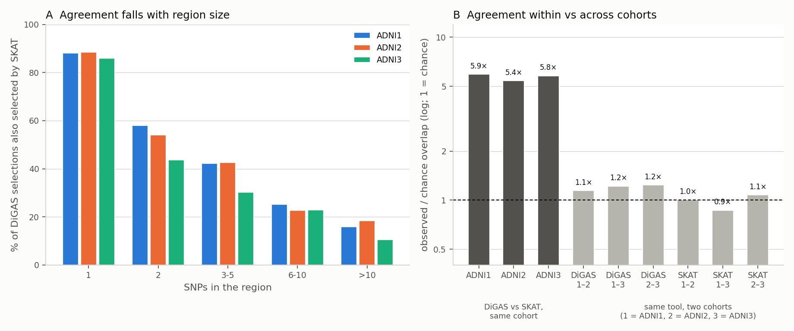

# Which regions do DiGAS and SKAT select in common?

*Whole-cohort selections: exon_5k in ADNI1, ADNI2 and ADNI3, plus ADNI1 exon and exon_protein_coding. 18 November 2026.*

## Summary

- **Within a cohort, the two tools agree far more than chance.** 50–71% of the regions DiGAS selects are also selected by SKAT, which is 5–8 times the overlap expected by chance (hypergeometric p ≈ 0 in every case). Over all tested regions, the two tools' p-values correlate with Spearman ρ = 0.38–0.56.
- **Most of the agreement comes from small regions.** When a region has a single SNP, both tools are in effect testing the same SNP: 86–91% of DiGAS's single-SNP selections are also SKAT selections. For regions with more than 10 SNPs, this falls to 0–18%. Half of the common set are single-SNP regions. DiGAS-only regions are larger (median 3–5 SNPs) and more often protein-coding.
- **Neither tool's selection replicates across cohorts.** The same tool run on two cohorts overlaps at 0.9–1.2 times chance. The common (DiGAS ∩ SKAT) set does no better (0.2–1.7 times chance), and no region is common in all three cohorts. Agreement between the tools on one cohort therefore reflects the shared data, not a shared biological signal.
- **Known AD genes:**
    - **SKAT finds the APOE locus; DiGAS does not.** SKAT selects TOMM40 at p = 4 × 10⁻⁹ in ADNI1 and APOE at p = 2 × 10⁻⁹ in ADNI2. DiGAS gives TOMM40 p = 0.41 (ADNI1) and APOE p = 0.055 (ADNI2). Neither tool finds it in ADNI3, which has 17 AD subjects.
    - Using 134 genes reported for AD at p < 5 × 10⁻⁸ in 3 or more GWAS Catalog publications, SKAT-only selections are enriched in ADNI1 (21 genes at 12 loci; p = 0.0004, size-adjusted). There is no enrichment in ADNI2 or ADNI3, and none for DiGAS-only selections in any cohort. The common set is enriched only in ADNI2, weakly (4 genes at 3 loci, p = 0.048).
- **Sex-chromosome regions are over-represented.** Neither tool adjusts for sex, and in ADNI2 the diagnosis groups differ in sex ratio. chrX and chrY regions are enriched 1.4–6.9 times in the common set, and 3–4 times in DiGAS-only selections in ADNI2 and ADNI3. SKAT-only selections show no such excess.
- **Pathways:** after adjusting for region size, 9 GO/Reactome terms reach FDR < 0.05, each in only one cohort. No term is significant in two cohorts. The size adjustment removes the apparent DiGAS-only enrichments (muscle fibre, stress fibre, synaptic membrane), which are typical long-gene artifacts.
- **Link to the unsupervised analysis:** the common regions carry most of the CN vs AD neighbour structure. With 28–31% of the SNPs, they reach a 10-NN excess of 0.177, 0.160 and 0.084 (ADNI1/2/3), compared with 0.179, 0.168 and 0.089 for the full DiGAS sets.

## 1. Data and methods

**Selections.** These are each tool's whole-cohort selections, with the same rules as the classification pipeline. A region is selected when its CN-vs-AD or CN-vs-MCI test has p ≤ 0.05. The ADNI1 exon_5k selections are the ones used in the unsupervised report. The others come from `results/tool_comparison/selection_all/`.

**Tested universe.** The universe is every region tested by both tools in that cohort. Region size is the number of SNPs SKAT tested in the region.

**Overlap.** Overlap is measured with counts, Jaccard, the overlap coefficient (common / smaller set) and fold over chance (observed / expected, with expected = n_DiGAS × n_SKAT / N). Significance is a hypergeometric test, plus a second expectation computed within region-size deciles.

**Concordance.** Concordance is the Spearman correlation of the two tools' p-values over all tested regions, and the overlap of their top-k regions.

**Cross-cohort.** Each tool's exon_5k selection is compared between pairs of cohorts, within the regions tested in both.

**Annotation.** All annotation sources are public files in `annotation/`:

- **GENCODE v44 (GRCh37 mapping):** gene symbol and biotype, matched by stable Ensembl ID. 99.7% of regions were annotated.
- **HGNC:** gene descriptions.
- **GO annotations and ontology:** propagated up is_a and part_of.
- **Reactome pathways.**
- **GWAS Catalog (v2 API), all Alzheimer disease associations (MONDO_0004975):**
    - 6,852 associations; 1,968 genes map to associations with p < 5 × 10⁻⁸.
    - That list is dominated by proxy, family-history and polygenic-score studies, so "known AD genes" means genes reported in **3 or more independent publications**.
    - This leaves 134 genes, including APOE, TOMM40, BIN1, CLU, PICALM, CR1, ABCA7, TREM2, SORL1, MS4A6A and CD2AP.

**Enrichment.** Each of Common, DiGAS-only and SKAT-only is tested against the tested universe. Terms with 10–500 tested genes are tested with a one-sided Fisher test. Because DiGAS-only regions are larger, a **size-adjusted** test is also reported:

- Each term gene is assumed to be selected with the selection rate of its size class (SNP-count bin).
- The p-value is the exact Poisson-binomial tail.
- FDR is Benjamini–Hochberg within each library.
- Neighbouring genes share SNPs in exon_5k, so the number of distinct loci (genes more than 1 Mb apart) is reported next to every hit.

No permuted or fake labels were used. Every reference is analytic or a label-free random region set.

## 2. Quantitative overlap

### 2.1 The two tools on the same cohort

| Cohort / region file | Regions tested | DiGAS | SKAT | Common | Expected | Fold | Jaccard | Common / DiGAS |
|---|---:|---:|---:|---:|---:|---:|---:|---:|
| ADNI1 exon_5k | 44,170 | 1,276 | 4,056 | 694 | 117 | 5.9 | 0.15 | 54% |
| ADNI2 exon_5k | 46,289 | 1,440 | 4,248 | 715 | 132 | 5.4 | 0.14 | 50% |
| ADNI3 exon_5k | 36,110 | 1,046 | 3,078 | 518 | 89 | 5.8 | 0.14 | 50% |
| ADNI1 exon | 18,141 | 532 | 1,614 | 376 | 47 | 7.9 | 0.21 | 71% |
| ADNI1 exon_protein_coding | 10,988 | 316 | 943 | 210 | 27 | 7.7 | 0.20 | 66% |

The table pools the CN-vs-AD and CN-vs-MCI selections, which is the set used downstream. Per contrast, the fold over chance is 8.8–14.4. All hypergeometric p-values are below 10⁻¹⁰⁰.

- **SKAT selects about 3 times as many regions as DiGAS.** SKAT's per-contrast selection rate is about 5%, the rate expected under no association. DiGAS's is about 1.5%.
- **Region size does not drive how often either tool selects** (rates are flat across SNP-count bins). The size-stratified expected overlap equals the plain one to within 1%.
- **The p-values agree over the whole range:**

| | ADNI1 exon_5k | ADNI2 exon_5k | ADNI3 exon_5k | ADNI1 exon | ADNI1 protein-coding |
|---|---:|---:|---:|---:|---:|
| Spearman ρ of p-values, CN-AD | 0.41 | 0.38 | 0.45 | 0.56 | 0.52 |
| Top-100 CN-AD regions in common (chance ≈ 0.2–0.9) | 23 | 24 | 10 | 38 | 38 |

### 2.2 Agreement depends on region size

| Region size (SNPs) | 1 | 2 | 3–5 | 6–10 | > 10 |
|---|---:|---:|---:|---:|---:|
| ADNI1: % of DiGAS selections also selected by SKAT | 88 | 58 | 42 | 25 | 16 |
| ADNI2 | 88 | 54 | 43 | 23 | 18 |
| ADNI3 | 86 | 44 | 30 | 23 | 11 |

- **Single-SNP regions:** both tools reduce to a test of one SNP's genotype distribution in two groups, so they agree almost always.
- **Larger regions:** DiGAS's region-level statistic and SKAT's variance-component test weight SNPs differently, so they diverge.
- **What each set contains:**

| Set (exon_5k) | Median SNPs per region | Single-SNP regions | Protein-coding |
|---|---:|---:|---:|
| All tested | 2–3 | 25–39% | 40–44% |
| Common | 1–2 | 45–57% | 28–36% |
| DiGAS-only | 3–5 | 6–9% | 50–59% |
| SKAT-only | 2–3 | 23–38% | 40–43% |

### 2.3 No replication across cohorts

| Cohort pair | DiGAS: common / expected | SKAT: common / expected | DiGAS ∩ SKAT: common / expected |
|---|---:|---:|---:|
| ADNI1–ADNI2 | 41 / 35.8 (1.1×, p = 0.21) | 340 / 337 (1.0×, p = 0.44) | 12 / 8.5 (1.4×, p = 0.15) |
| ADNI1–ADNI3 | 33 / 27.0 (1.2×, p = 0.14) | 217 / 250 (0.9×, p = 0.99) | 1 / 6.0 (0.2×, p = 1.00) |
| ADNI2–ADNI3 | 37 / 29.9 (1.2×, p = 0.11) | 284 / 263 (1.1×, p = 0.09) | 10 / 6.0 (1.7×, p = 0.08) |

- Selected in all three cohorts: DiGAS 1 region, SKAT 21 (chance ≈ 22), common set 0.
- **Neither tool's whole-cohort selection is reproduced in another ADNI cohort beyond chance.** This also holds for the regions both tools agree on.

### 2.4 The common regions in the unsupervised analysis

Each set below was analysed on CN + AD subjects with the same PCA and 10-NN measure as the unsupervised report. Random sets are size-matched (5 draws).

| Cohort | Set | Regions | SNPs | 10-NN excess, PCA 50 | Random sets, max |
|---|---|---:|---:|---:|---:|
| ADNI1 | Common | 694 | 1,803 | **0.177** | 0.005 |
| | DiGAS-only | 582 | 4,047 | 0.113 | 0.010 |
| | SKAT-only | 3,362 | 15,323 | 0.145 | 0.017 |
| | DiGAS (all) | 1,276 | 5,815 | 0.179 | 0.010 |
| | SKAT (all) | 4,056 | 16,960 | 0.158 | 0.005 |
| ADNI2 | Common | 715 | 2,041 | **0.160** | 0.009 |
| | DiGAS-only | 725 | 5,376 | 0.119 | 0.015 |
| | SKAT-only | 3,533 | 19,199 | 0.101 | 0.016 |
| | DiGAS (all) | 1,440 | 7,344 | 0.168 | 0.005 |
| | SKAT (all) | 4,248 | 21,008 | 0.122 | 0.016 |
| ADNI3 | Common | 518 | 1,032 | **0.084** | 0.007 |
| | DiGAS-only | 528 | 2,726 | 0.062 | 0.020 |
| | SKAT-only | 2,560 | 7,692 | 0.069 | 0.011 |
| | DiGAS (all) | 1,046 | 3,722 | 0.089 | −0.001 |
| | SKAT (all) | 3,078 | 8,625 | 0.080 | 0.010 |

- With only 28–31% of the SNPs, **the common regions give almost the whole CN vs AD neighbour signal of the full DiGAS set**, and more than the full SKAT set.
- The common set consists of the SNPs with the strongest individual CN-vs-AD differences, picked up by both tests. On the subjects they were selected from, those SNPs separate the groups best.
- The k-means ARI on the subsets is as unstable as in the unsupervised report: up to 0.30 for the ADNI1 common set and 0.11 for ADNI2 DiGAS-only, and about 0 elsewhere.

## 3. Qualitative: what the common regions are

### 3.1 Region types and chromosomes

- **Biotypes:** the common set is enriched for pseudogenes and short non-coding loci. DiGAS-only selections are enriched for protein-coding genes (50–59% against 40–44% of all regions). This follows from region size (Section 2.2).
- **The top common regions by p-value include many sex-chromosome loci in every cohort:**
    - ADNI1: TBL1YP1 (chrY).
    - ADNI2: RPS4Y1 (chrY), XG (chrX) and an unnamed chrX pseudogene.
    - ADNI3: FAM41AY1 and ZFY-AS1 (chrY).

| Cohort | Male fraction CN / MCI / AD | CN vs AD | CN vs MCI | chrX regions: Common / DiGAS-only / SKAT-only (fold) | chrY regions: Common / DiGAS-only / SKAT-only (fold) |
|---|---|---:|---:|---|---|
| ADNI1 | 0.55 / 0.65 / 0.55 | p = 1.0 | p = 0.03 | 1.6× / 0.9× / 1.1× | 1.7× / 1.8× / 0.5× |
| ADNI2 | 0.46 / 0.57 / 0.59 | p = 0.03 | p = 0.01 | 1.4× / **3.0×** / 0.7× | 2.1× / **3.2×** / 1.0× |
| ADNI3 | 0.35 / 0.57 / 0.57 (188 of 327 with unknown sex) | p = 0.43 | p = 0.09 | 1.9× / **4.2×** / 1.2× | **6.9×** / 3.2× / 0.7× |

Bold = Fisher p ≤ 0.001.

- **Why this happens:** neither tool adjusts for sex. SKAT's null model is `y ~ 1` (the collaborator's settings), and DiGAS takes no covariates.
- With carrier coding, chrX genotypes differ systematically between men (hemizygous) and women, and chrY SNPs are only observed in men. Wherever the diagnosis groups differ in sex ratio, sex-chromosome regions look associated with diagnosis.
- DiGAS-only selections pick up more of these regions than SKAT-only ones. This matches the unsupervised finding that chrX held 15% of the ADNI2 diagnosis axis (6% of SNPs).
- ADNI3 is a special case: sex is missing for 188 of its 327 subjects in the .fam file, and the strong chrY excess there may partly reflect how the tools handle those subjects.

### 3.2 Known AD genes

**APOE locus (chr19q13.32):**

| | ADNI1 | ADNI2 | ADNI3 |
|---|---|---|---|
| SKAT, CN-AD | TOMM40 4 × 10⁻⁹, APOC1 1 × 10⁻⁴, APOE 0.01 | **APOE 2 × 10⁻⁹** | APOE 0.38, TOMM40 1.0 |
| DiGAS, CN-AD | TOMM40 0.41, APOC1 0.014, APOE 0.077 | APOE 0.055, TOMM40 0.97 | APOE 0.46, TOMM40 0.018 |
| In the common set | APOE, APOC1 (CN-MCI / CN-AD at p ≤ 0.05) | no | no |

- **SKAT detects the strongest known AD locus in both well-powered cohorts.** DiGAS ranks it near or below the selection threshold.
- DiGAS's permutation p-values have a floor of 0.001 (1,000 iterations), so DiGAS cannot reach genome-wide significance at all. However, here it doesn't even reach p ≤ 0.05 for TOMM40 or APOE in ADNI1 and ADNI2.
- The other established loci (BIN1, CLU, PICALM, TREM2, SORL1) are not selected by either tool in any cohort. With 118–168 AD subjects per cohort that is expected, since most of these loci have odds ratios of 1.1–1.3.

**Enrichment for the 134 replicated AD genes:**

| Cohort / region file | Common: hits (loci), p | DiGAS-only: hits (loci), p | SKAT-only: hits (loci), p |
|---|---|---|---|
| ADNI1 exon_5k | 2 (1), 0.41 | 3 (3), 0.34 | **21 (12), 0.0004** |
| ADNI2 exon_5k | 4 (3), 0.048 | 3 (3), 0.47 | 11 (8), 0.41 |
| ADNI3 exon_5k | 2 (2), 0.36 | 2 (2), 0.70 | 10 (8), 0.31 |
| ADNI1 exon | 0 | 0 | **14 (9), 0.0002** |
| ADNI1 exon_protein_coding | 0 | 0 | **12 (9), 0.0005** |

p is the size-adjusted value.

- The ADNI1 SKAT-only hits include CR1, FERMT2, APP, HLA-DQA1, TOMM40, NECTIN2 and the APOC4–APOC2 cluster.
- The ADNI2 common hits are BCL3, RELB, IDUA and CD2AP-DT. BCL3 is also common in ADNI3, but that is a single gene near the APOE region on chr19.

### 3.3 Pathways

- **Unadjusted:** 29 terms reached FDR < 0.05. All were in DiGAS-only selections (13 in ADNI1, 4 in ADNI2, 12 in ADNI3): muscle fibre and stress fibre, P-body, postsynaptic and synaptic membrane, chloride channels. These are the gene categories with the longest genes, so they are flagged whenever selection favours larger regions.
- **Size-adjusted:** 9 terms remain, all in single cohorts:
    - ADNI2 common set: postsynaptic density, neuron-to-neuron and asymmetric synapse (13–14 genes at 13–14 loci, FDR 0.004), plus bile-acid transport (SLCO genes, one locus).
    - ADNI3 DiGAS-only: regulation of PTEN mRNA translation (4 genes, 2 loci).
- **Replication:** at nominal size-adjusted p < 0.01, only 5 terms recur in two exon_5k cohorts (tRNA 5′-end processing, peroxisomal transport, megakaryocyte development and two related terms). None recur in all three. Each cohort and set tested 975–6,082 terms, so this is about what chance gives.

The ADNI2 synapse result is the most biologically suggestive finding. It does not appear in ADNI1 or ADNI3, so on this evidence it should be treated as a single-cohort observation.

## 4. Interpretation

1. **Agreement measures shared data more than shared biology.** On the same subjects, both tools respond to the same sample differences, most directly in single-SNP regions. Across cohorts, the agreement disappears for both tools and for their intersection. The overlap therefore says that DiGAS and SKAT read the data similarly, not that the commonly selected regions are disease genes.
2. **The tools differ mainly in larger regions.** That is where DiGAS's own contribution lies. DiGAS-only regions are larger and more often protein-coding. They are enriched for sex-chromosome loci in the sex-imbalanced cohorts. They carry less of the CN vs AD structure than the common set, and are not enriched for known AD genes.
3. **On established biology SKAT does better.** It recovers the APOE locus in ADNI1 and ADNI2, and its ADNI1-specific selections are enriched for replicated AD genes. DiGAS misses APOE in both cohorts.
4. **Neither tool has a covariate model for sex.** Adding sex as a covariate (SKAT), or restricting to autosomes, is a straightforward fix. It should be applied before any biological reading of the selections.

## 5. Limitations

- All selections are whole-cohort selections, so the comparison inherits their circularity. A region selected in one cohort is an observation about that cohort.
- Region files overlap: neighbouring genes share SNPs, especially in exon_5k. Locus counts are reported, but enrichment p-values still treat genes as independent.
- The size adjustment uses SNP count bins, not gene length or LD. Residual length bias is possible.
- "Known AD genes" depends on the GWAS Catalog's gene mapping, and on the 3-publication cut-off.
- ADNI3 has 17 AD subjects and unknown sex for most subjects. Its results are the least informative.

## Reproducibility

| Step | Command | Output |
|---|---|---|
| Overlap, concordance, cross-cohort, unsupervised subsets | `.venv/bin/python scripts/analysis/selection_overlap.py` | `results/selection_overlap/*.csv`, `report.txt` |
| Annotation, sex chromosomes, AD genes, enrichment | `.venv/bin/python scripts/analysis/selection_overlap_annot.py` | `results/selection_overlap/annot/` |
| Figure 1 | `.venv/bin/python scripts/analysis/selection_overlap_figs.py` | `results/selection_overlap/report/fig_overlap.png` |

The annotation files were downloaded on 18 November 2026: GENCODE v44 lift37 basic GTF, HGNC complete set, goa_human.gaf, go-basic.obo, ReactomePathways.gmt, and GWAS Catalog v2 associations for MONDO_0004975 (69 pages in `annotation/gwas_ad/`). The per-region tables of the common sets, with symbols, biotypes, descriptions and both tools' p-values, are in `results/selection_overlap/annot/common_annotated_<cohort>_<region>.csv`.
