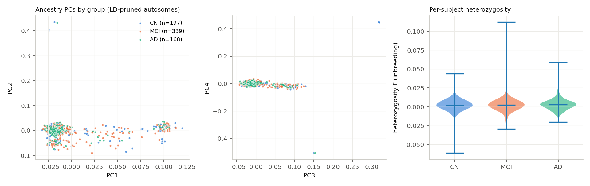
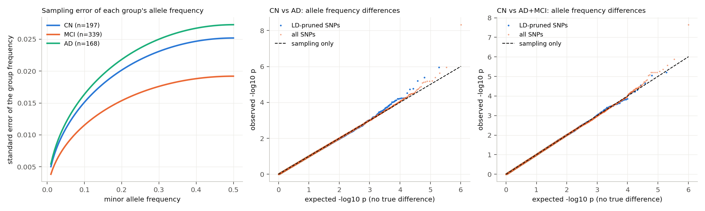
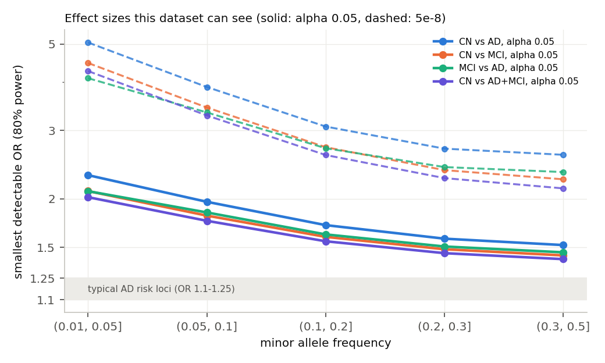
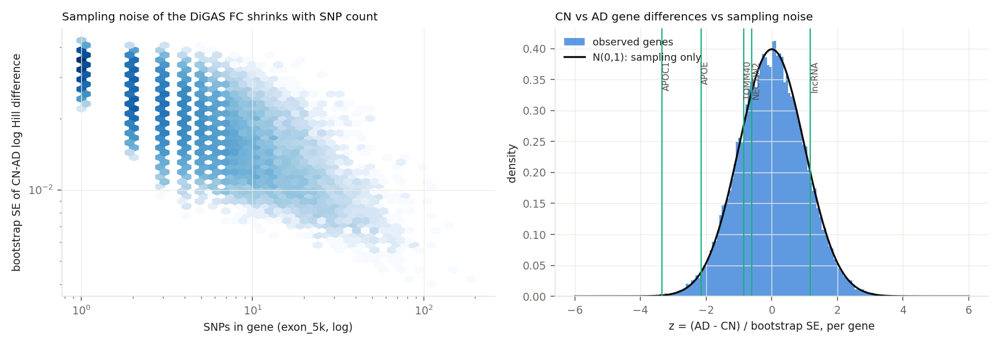

# Genetic variability of ADNI1 by diagnosis group: a model-free analysis

*Date: 2026-11-12 · Script: `scripts/analysis/snp_variability.py` (about 3 min) · Outputs: `results/snp_variability/`*

## Question

The DiGAS classification results fall to chance once feature selection is kept inside cross-validation.
One explanation is that the data vary too much for any gene-level method to find a stable signal.
This analysis measures that variability directly, **without a classifier and without shuffled labels**:

1. each SNP within each diagnosis group (CN, MCI, AD);
2. the three groups compared SNP by SNP, then summed over the whole cohort;
3. what effect sizes the dataset can detect at all;
4. the same at gene level, the unit DiGAS works on;
5. whole-dataset structure (ancestry, relatedness, heterozygosity, missingness).

Every reference (null) distribution comes from sampling theory (binomial or χ² distributions, or a within-group bootstrap), not from permuted labels.

## Data

| | |
|---|---|
| Genotypes | `ADNI1_QC` (PLINK 1.9 binary), 704 subjects |
| Groups | CN 197 · MCI 339 · AD 168 (`pheno/adni1pheno.txt`) |
| SNPs analysed | 512,641 autosomal SNPs (chr 1–22; chrX/Y/XY excluded) |
| Approximately independent subset | 95,109 SNPs: MAF ≥ 0.05, LD-pruned (`--indep-pairwise 50 5 0.2`) |
| Gene regions | `region/exon_5k.txt`: 44,170 genes with at least 1 SNP |

All frequencies refer to the minor allele of the whole cohort, so the three groups are always compared on the same allele.

## Summary of findings

1. **The cohort is homogeneous and technically clean.** None of these differ between diagnosis groups: ancestry, relatedness, heterozygosity, genotype missingness, Hardy–Weinberg equilibrium. The only imbalance is sex, and it is small: 35% women in MCI vs 45% in CN and AD.
2. **Within each group, SNP frequencies vary exactly as binomial sampling predicts:** bootstrap SD / binomial SE = 0.99–1.00. That sampling error is large compared with known Alzheimer's effects: about ±0.04–0.05 (95%) on each group frequency.
3. **Between groups, genome-wide allele frequencies differ by no more than sampling noise.**
   - λ = 1.00–1.02.
   - Estimated share of SNPs with a true frequency difference (Storey π₁): ≤ 1%.
   - Hudson Fst ≈ 0.
   - Only rs2075650 (TOMM40/APOE) reaches genome-wide significance.
4. **The dataset can only detect large effects:** odds ratios ≥ 1.4–2.3 at p < 0.05 with 80% power. Typical AD risk loci have OR 1.1–1.25 and would need thousands of subjects per group.
5. **At gene level, CN vs AD differences in DiGAS's Hill score follow the sampling-only N(0,1) curve.** The exceptions are the APOE region (APOC1 z = −3.3, APOE z = −2.2).
   - Sampling noise is about 5× larger for genes with a single SNP than for genes with more than 50 SNPs.
   - So the raw DiGAS FC ranks the noisiest genes first: 1-SNP genes are 31% of genes but 71% of the top 1,270 by FC.

**Interpretation.** The variability that limits ADNI1 is not heterogeneity, artefact or population structure. It is sampling error, which follows from the sample size. Apart from APOE, the effects that exist in Alzheimer's genetics are smaller than this dataset can resolve, so no method can be validated on it beyond APOE. Separately, DiGAS ranks genes by raw FC without dividing by its uncertainty. That makes its ranking extra sensitive to this noise, and it can be fixed (see *Implications*).

---

## 1. Whole-dataset structure

Ancestry PCs, kinship and heterozygosity were computed with PLINK on the 95,109 LD-pruned SNPs.

| Test | Statistic | p | CN | MCI | AD |
|---|---|---|---|---|---|
| PC1 by group (Kruskal–Wallis) | 2.66 | 0.26 | | | |
| PC2–PC10 by group | 0.12–4.52 | 0.10–0.94 | | | |
| Heterozygosity F by group (median) | 0.29 | 0.86 | 0.0022 | 0.0026 | 0.0028 |
| Sex by group (χ², share female) | 7.11 | **0.029** | 0.447 | 0.348 | 0.446 |

**Relatedness** (PLINK `PI_HAT`):

| Pairs | n | Mean PI_HAT | Pairs with PI_HAT > 0.1875 |
|---|---|---|---|
| within CN | 19,306 | 0.0038 | 1 |
| within MCI | 57,291 | 0.0032 | 0 |
| within AD | 14,028 | 0.0044 | 0 |
| between groups | 156,831 | 0.0037 | 1 |

There are two first-degree pairs (PI_HAT ≈ 0.51): one CN–CN pair and one CN–AD pair (subject IDs are not published; ADNI data use agreement). Two pairs among 704 subjects have no measurable effect on the analyses below, but they should be removed in a final analysis.

## 2. Each SNP within each group

For every SNP and group, the script computes:
- minor-allele and carrier frequency
- observed and expected heterozygosity
- missingness
- Hardy–Weinberg exact p (PLINK `--hardy` per group)
- the binomial SE of the allele frequency, sqrt(p(1−p)/2n)
- a 200-replicate within-group subject bootstrap

| Group | n | Median SE of allele frequency | Bootstrap SD / binomial SE (median) | HWE p < 1e-3: observed / expected | HWE p < 1e-6: observed / expected |
|---|---|---|---|---|---|
| CN | 197 | 0.022 | 0.99 | 422 / 513 | 0 / 0.5 |
| MCI | 339 | 0.017 | 1.00 | 624 / 513 | 2 / 0.5 |
| AD | 168 | 0.024 | 1.00 | 417 / 513 | 0 / 0.5 |

- Within-group variation is pure sampling variation; there is no extra variance.
- Hardy–Weinberg deviations are at or below chance in CN and AD. MCI shows a mild excess at p < 1e-3 (624 vs 513), as expected from its larger n giving more power to detect small genotyping deviations. Only 2 SNPs fall below 1e-6.
- **Differential missingness** across the three groups (χ², df 2, on the 282,563 SNPs with any missing call) is below chance: 49 SNPs at p < 1e-3 vs 283 expected, 1 at p < 1e-6 vs 0.28. There is no sign of group-specific batch or genotyping effects.

The SE of a group frequency peaks at about 0.025 (CN, AD) and 0.019 (MCI) at MAF 0.5 (first panel of the figure in section 3). Most known Alzheimer's risk variants change allele frequency by about 0.01–0.03.

## 3. Comparing the groups, SNP by SNP and genome-wide

For each SNP, the script ran an allelic χ² test for all three groups together (df 2) and for each pair (df 1), and computed Hudson's Fst for each pair. The whole-cohort summaries are:
- λ_GC: median χ² divided by its expected value; 1 means no inflation.
- Storey π₁ = 1 − π₀, with λ = 0.5: the estimated share of SNPs whose frequency truly differs.
- Observed vs expected counts in the tail.
- Genome-wide Hudson Fst (ratio of averages), with a 22-chromosome jackknife SE.

### All 512,641 autosomal SNPs

| Comparison | λ_GC | π₁ | p<1e-3 obs/exp | p<1e-4 | p<1e-5 | p<1e-6 | p<5e-8 | Fst | Fst z |
|---|---|---|---|---|---|---|---|---|---|
| CN vs AD | 1.013 | 0.006 | 543 / 513 | 60 / 51 | 10 / 5.1 | 1 / 0.5 | 1 / 0.03 | 1.5e-5 | 0.79 |
| CN vs MCI | 1.004 | 0.002 | 491 / 513 | 52 / 51 | 4 / 5.1 | 0 / 0.5 | 0 / 0.03 | 1.1e-5 | 1.03 |
| MCI vs AD | 1.009 | 0.004 | 541 / 513 | 47 / 51 | 3 / 5.1 | 0 / 0.5 | 0 / 0.03 | 2.1e-5 | 1.30 |
| CN vs AD+MCI | 1.005 | 0.002 | 498 / 513 | 52 / 51 | 11 / 5.1 | 1 / 0.5 | 1 / 0.03 | 0.8e-5 | 0.84 |
| CN / MCI / AD (df 2) | 1.006 | 0.005 | 510 / 513 | 50 / 51 | 8 / 5.1 | 2 / 0.5 | 1 / 0.03 | – | – |

### 95,109 LD-pruned SNPs (approximately independent)

| Comparison | λ_GC | π₁ | p<1e-3 obs/exp | p<1e-4 | p<1e-5 | Fst | Fst z |
|---|---|---|---|---|---|---|---|
| CN vs AD | 1.022 | 0.010 | 103 / 95 | 18 / 9.5 | 3 / 0.95 | 2.0e-5 | 1.21 |
| CN vs MCI | 1.006 | 0.002 | 91 / 95 | 8 / 9.5 | 0 / 0.95 | 1.4e-5 | 1.28 |
| MCI vs AD | 1.001 | 0.001 | 104 / 95 | 12 / 9.5 | 0 / 0.95 | 0.1e-5 | 0.11 |
| CN vs AD+MCI | 1.014 | 0.006 | 100 / 95 | 9 / 9.5 | 2 / 0.95 | 1.6e-5 | 1.86 |

- Genome-wide, the three groups are not differentiated: every Fst z is below 2.
- At most about 1% of SNPs carry a true frequency difference, and the QQ curves sit on the sampling-only line.
- The only clear excess is in the extreme tail of the comparisons that include AD, which is the APOE locus.

**Top SNPs for CN vs AD+MCI** (full list of 30 in `top_snps_CN_vs_ADMCI.csv`):

| SNP | chr:pos | MAF CN / MCI / AD | p CN vs AD | p CN vs AD+MCI | Genes within 20 kb |
|---|---|---|---|---|---|
| rs2075650 | 19:45,395,619 | 0.145 / 0.268 / 0.327 | **4.7e-9** | **2.3e-8** | TOMM40, APOE, NECTIN2, lncRNA ENSG00000267282 |
| rs11595021 | 10:64,663,270 | 0.168 / 0.080 / 0.080 | 3.9e-4 | 1.3e-6 | ENSG00000122877 |
| rs1052242 | 15:74,320,478 | 0.498 / 0.360 / 0.363 | 2.6e-4 | 2.7e-6 | ENSG00000140464, ENSG00000287543 |
| rs9896368 | 17:34,083,465 | 0.117 / 0.040 / 0.066 | 1.8e-2 | 4.4e-6 | 4 genes (chr17 cluster) |
| rs8141950 | 22:44,393,476 | 0.023 / 0.091 / 0.098 | 1.4e-5 | 5.5e-6 | ENSG00000100347, ENSG00000188677 |

Only rs2075650 passes 5e-8. The next SNPs are at the level about 5 SNPs per 10⁻⁵ would reach by chance across 512k tests.

## 4. What the dataset can detect

The table gives the smallest allelic odds ratio detectable with 80% power, computed per SNP from its CN frequency and the actual group sizes, then summarized as the median within each MAF bin.

| Comparison (n) | α | MAF 0.01–0.05 | 0.05–0.1 | 0.1–0.2 | 0.2–0.3 | 0.3–0.5 |
|---|---|---|---|---|---|---|
| CN vs AD (197 vs 168) | 0.05 | 2.30 | 1.97 | 1.71 | 1.58 | 1.52 |
| | 5e-8 | 5.05 | 3.88 | 3.07 | 2.69 | 2.60 |
| CN vs MCI (197 vs 339) | 0.05 | 2.09 | 1.81 | 1.60 | 1.48 | 1.43 |
| | 5e-8 | 4.47 | 3.44 | 2.72 | 2.37 | 2.25 |
| MCI vs AD (339 vs 168) | 0.05 | 2.09 | 1.85 | 1.62 | 1.51 | 1.46 |
| | 5e-8 | 4.09 | 3.34 | 2.70 | 2.41 | 2.34 |
| CN vs AD+MCI (197 vs 507) | 0.05 | 2.02 | 1.76 | 1.56 | 1.45 | 1.40 |
| | 5e-8 | 4.26 | 3.28 | 2.59 | 2.26 | 2.13 |

**Subjects per group** (balanced) needed for 80% power, allelic test:

| OR | MAF 0.1, α 0.05 | MAF 0.1, α 5e-8 | MAF 0.3, α 0.05 | MAF 0.3, α 5e-8 |
|---|---|---|---|---|
| 1.10 | 9,247 | 46,652 | 4,040 | 20,384 |
| 1.15 | 4,227 | 21,327 | 1,864 | 9,404 |
| 1.20 | 2,444 | 12,332 | 1,087 | 5,486 |
| 1.50 | 456 | 2,299 | 213 | 1,074 |
| 3.00 (APOE-like) | 50 | 253 | 28 | 140 |

The full grid is in `power_sample_size_needed.csv`. Common AD risk loci outside APOE have per-allele OR of about 1.1–1.25 (large GWAS meta-analyses). ADNI1 has 168–339 subjects per group, 1–2 orders of magnitude fewer than needed. Only APOE-sized effects are within reach, which matches what sections 3 and 5 find.

## 5. Gene level (exon_5k, DiGAS's unit)

**Method.**
- Each subject gets a per-gene Hill value: the weighted share of the gene's SNPs at which they carry the cohort minor allele. This is the same per-subject value as in `region_feature_pipeline.py`. Its group mean is the DiGAS Hill score.
- The CN–AD and CN–MCI difference is d = log1p(Hill_AD) − log1p(Hill_CN); |d| is DiGAS's FC.
- Its SE comes from a 200-replicate bootstrap of subjects within each group, and z = d / SE.
- With sampling alone, z ~ N(0,1).

This uses the cohort minor allele throughout. The original DiGAS chooses the minor allele separately in each group, so per-gene values can differ slightly from the published tool, but the noise argument is unchanged.

| SNPs per gene | Genes | Share of genes | Share of top-1,270 FC (CN vs AD) | Median FC | Median SE | SD of z | Share with \|z\| > 2 (expected 0.046) |
|---|---|---|---|---|---|---|---|
| 1 | 13,646 | 31% | **71%** | 0.023 | 0.034 | 1.01 | 0.047 |
| 2 | 8,761 | 20% | 17% | 0.017 | 0.026 | 0.99 | 0.045 |
| 3–5 | 11,635 | 26% | 10% | 0.014 | 0.021 | 1.01 | 0.049 |
| 6–10 | 5,951 | 13% | 1.4% | 0.011 | 0.016 | 1.00 | 0.048 |
| 11–20 | 2,899 | 7% | 0.2% | 0.009 | 0.013 | 1.02 | 0.049 |
| 21–50 | 1,152 | 3% | 0.1% | 0.007 | 0.010 | 1.00 | 0.043 |
| > 50 | 126 | 0.3% | 0% | 0.004 | 0.007 | 1.03 | 0.064 |

CN vs MCI gives the same picture: 71% of the top-1,270 are 1-SNP genes, and the SD of z is 1.00–1.08 (`gene_variability_by_snp_count.csv`).

- **In every SNP-count bin, the median FC is 0.64–0.70 × the median SE.** That is what |N(0,1)| sampling noise produces (its median is 0.67), so the typical gene's FC is pure noise.
- **Genes with fewer SNPs have larger noise and so larger FC.** Ranking by raw FC therefore fills the top of the list with 1-SNP genes. This is the mechanism behind an earlier finding: DiGAS's top genes are mostly single-SNP genes.
- **The z distribution matches N(0,1)** (SD 0.99–1.03; 4.3–4.9% beyond ±2 vs 4.55% expected). Gene-level group differences are therefore consistent with sampling noise across the genome.

**APOE-region genes** (CN vs AD):

| Gene | SNPs | FC | z (AD − CN) | FC rank / 44,170 | z CN vs MCI |
|---|---|---|---|---|---|
| APOC1 | 1 | 0.115 | **−3.34** | **15** | −2.06 |
| APOE | 1 | 0.060 | −2.15 | 1,421 | −2.45 |
| lncRNA ENSG00000267282 | 2 | 0.021 | 1.18 | 16,288 | 1.12 |
| TOMM40 | 3 | 0.010 | −0.85 | 28,485 | −0.43 |
| NECTIN2 | 8 | 0.008 | −0.61 | 31,428 | 0.71 |

TOMM40 holds the strongest single SNP in the genome (rs2075650), yet it is null at gene level. The Hill score averages carrier frequency over the gene's SNPs, and here rs2075650 goes up in AD while TOMM40's other SNPs go down, so they cancel.

---

## Implications

1. **ADNI1 is a clean but underpowered cohort.** The variability that defeats classification is sampling error, not heterogeneity or artefact. Any method, whether DiGAS, SKAT or a GWAS, will only find the APOE region here. A failure to validate on ADNI1 therefore says little for or against a method's ability to find small effects, but it also gives no evidence that a method does find them.
2. **Larger cohorts are needed** to test DiGAS on non-APOE genes: thousands per group (section 4). Examples: the full ADNI (ADNI1/GO/2/3), ADSP, or a meta-analysis across cohorts.
3. **DiGAS can be improved:**
   - Rank genes by FC / SE (or a variance-stabilized FC), not by raw FC, so that single-SNP genes are not favored just for their noise.
   - Score SNPs with opposite effects separately instead of averaging them, so that cases like TOMM40 don't cancel out.
4. **For the DiGAS vs SKAT comparison:** run it with the same splits and, where possible, on a larger cohort. On ADNI1 both tools will be limited by the power shown here.

## Caveats

- **Autosomes only.** chrX was excluded because of hemizygous coding in males.
- **Allelic tests assume HWE.** That assumption is supported here: HWE failures are at or below chance.
- **No covariates.** All analyses are unadjusted. The groups show no ancestry difference, so adjusting for PCs would change little. Sex differs mildly between groups (p = 0.03) and is not adjusted for.
- **π₁ with correlated SNPs.** The Storey estimator assumes independent tests. The LD-pruned results are the reliable version and agree with the all-SNP results.
- **Power uses the allelic z-test approximation**, per allele and additive. Known-locus ORs are approximate ranges from the literature.
- **Two first-degree pairs** remain in the data (section 1). Two pairs among 704 subjects have no measurable effect on these results.

## Files

| File | Contents |
|---|---|
| `structure_tests.csv`, `kinship_within_between.csv`, `related_pairs.csv` | Section 1 |
| `snp_by_group.csv.gz` | Per SNP × group: frequencies, SEs, bootstrap SDs, HWE, missingness, pairwise χ²/p/Fst, minimum detectable OR |
| `cohort_summary.csv` | λ, π₁, tail counts, genome-wide Fst, within-group SE checks, differential missingness |
| `power_min_detectable_or.csv`, `power_sample_size_needed.csv` | Section 4 |
| `top_snps_CN_vs_ADMCI.csv` | Top 30 SNPs with nearby genes |
| `gene_variability_exon_5k.csv.gz`, `gene_variability_by_snp_count.csv` | Section 5 |
| `plink/` | PLINK intermediate files (pruning, PCA, genome, het, hardy) |
| `*.png` / `*.pdf` | Figures |
