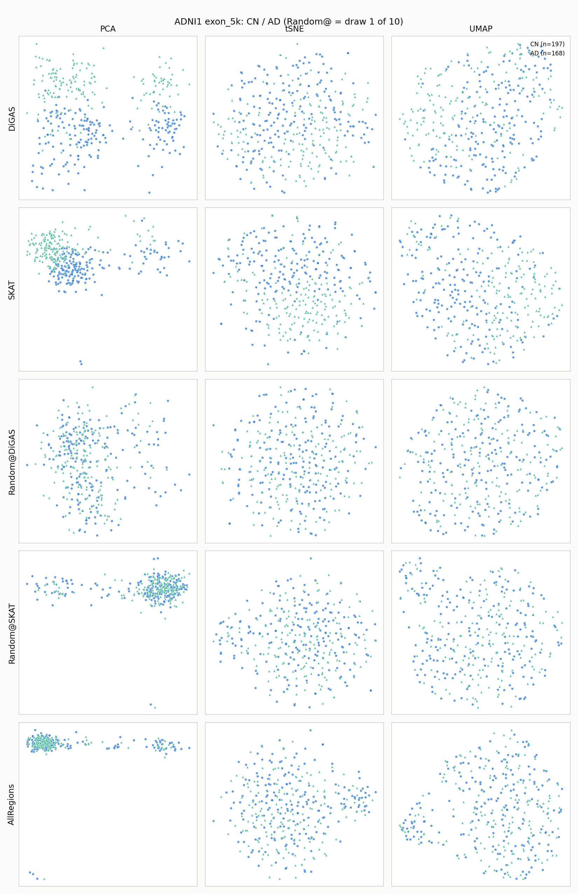
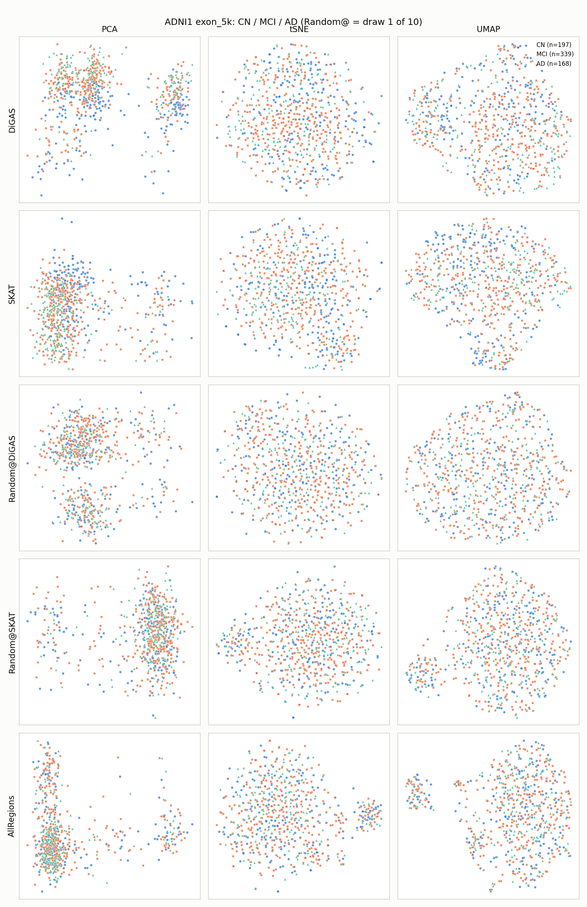
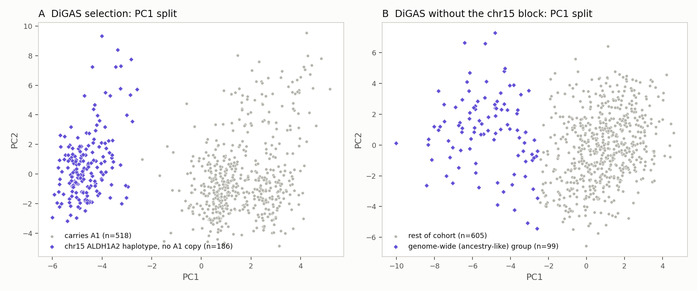
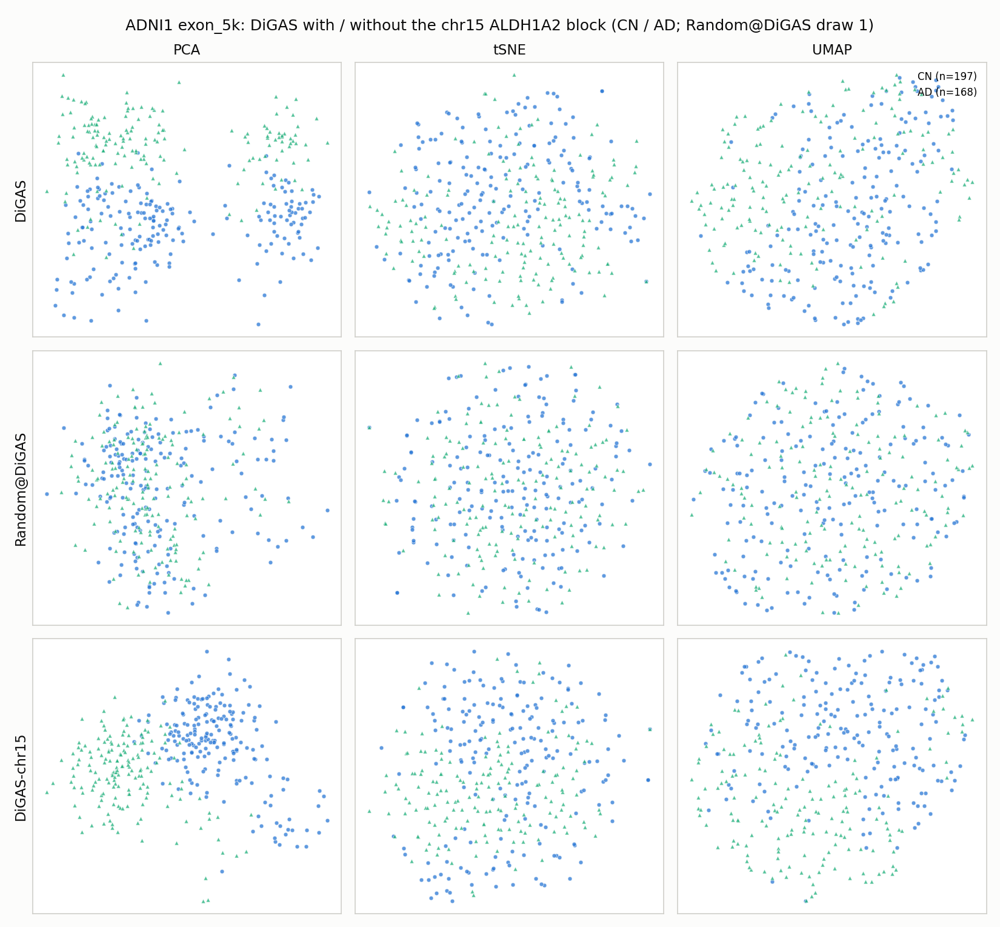
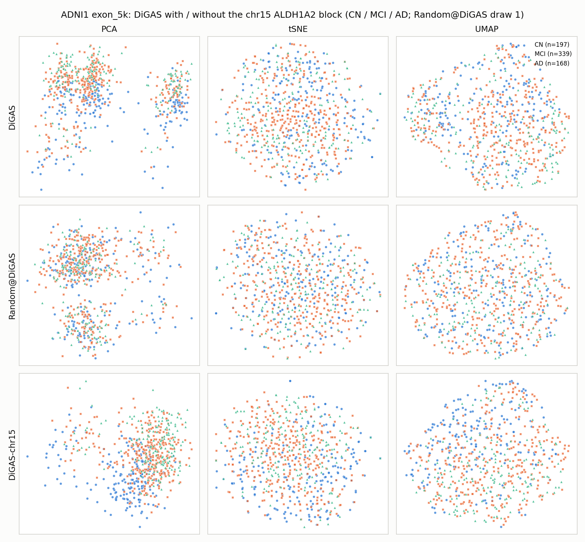
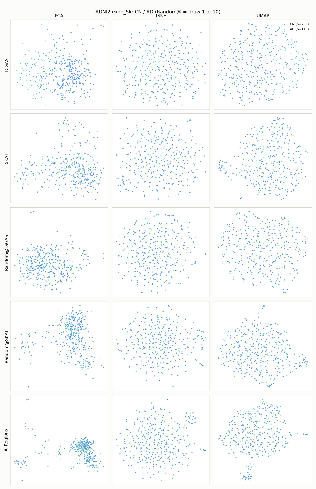
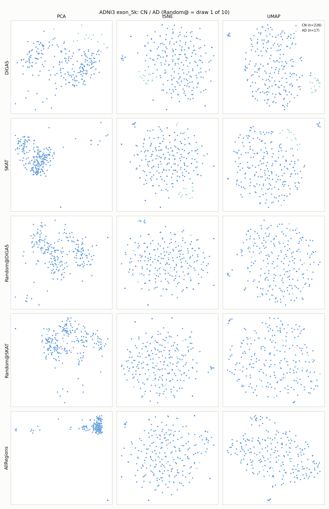
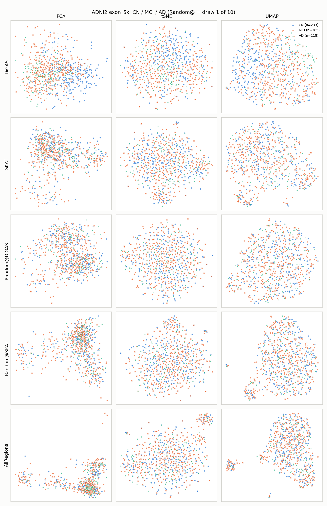
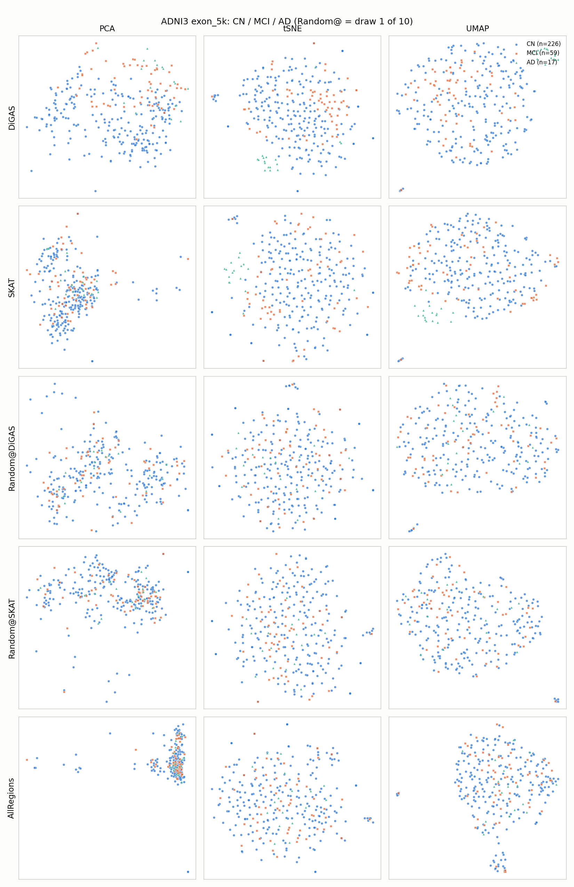

# DiGAS vs SKAT without a classifier: unsupervised analysis of the selected regions

*ADNI1, ADNI2 and ADNI3, exon_5k region file. First version 13 November 2026 (ADNI1); updated 18 November 2026 with ADNI2 and ADNI3 (Sections 3.5–3.7).*

## Summary

- We ran DiGAS and SKAT on each **whole cohort** (ADNI1, ADNI2, ADNI3), kept the regions each tool selected, and then examined the subjects' genotypes on those regions **without any classifier**. We used PCA, clustering, t-SNE and UMAP, and compared the result with the known diagnosis (CN / MCI / AD). Each cohort used its own selections.
- **Both tools' regions place subjects next to others with the same diagnosis, in all three cohorts.** For CN vs AD, 10-nearest-neighbour agreement (PCA, 50 PCs) is +0.09 to +0.18 above chance for both tools. Random regions of the same size and all exon_5k regions give about 0 everywhere.
- **On this neighbour measure DiGAS is slightly ahead of SKAT in every cohort** (CN vs AD: 0.179 vs 0.158 in ADNI1, 0.168 vs 0.122 in ADNI2, 0.089 vs 0.080 in ADNI3). In the 2D views the two are about even in ADNI1, and DiGAS is clearly ahead in ADNI2.
- **Clusters match diagnosis only with k-means, and unstably.** The best CN vs AD ARI is 0.33 (DiGAS) vs 0.21 (SKAT) in ADNI1, and **0.70 vs 0.02 in ADNI2**. In ADNI3, which has only 17 AD subjects, both are about 0. Small changes to the region set move the k-means ARI between about 0 and 0.9 (Section 3.7), so this index is not a reliable basis for ranking the tools.
- **The ADNI2 split is not a single locus.** It is a weak axis (0.8% of variance) spread over about 2,000 SNPs. Each SNP was selected for a small CN-vs-AD difference, and together they line up with diagnosis (Section 3.6). It is not batch, ancestry, sex or chrX. The CN-vs-AD regions produce it on their own; the CN-vs-MCI regions do not.
- **This separation is largely built in by the selection.** Both tools chose their regions using the diagnoses of these same subjects, and the ADNI2 analysis shows directly how this produces a diagnosis axis. A held-out test, with selection on training subjects and evaluation on unseen ones, is needed before reading it as biology.
- Two structures in the ADNI1 DiGAS PCA have nothing to do with diagnosis:
  1. A **common haplotype in ALDH1A2** (chr15) splits the cohort 186 / 518 along PC1.
  2. Once that is removed, a **genome-wide, ancestry-like group** of 99 subjects remains. It clusters by recruitment site and is **unevenly spread across diagnoses** (22% of CN vs 9.5% of AD, p = 0.0009). This is **population stratification** that could affect both tools' selections.

## 1. Data and feature sets

**Subjects:** 704 ADNI1 subjects after QC (CN 197, MCI 339, AD 168). All analyses were repeated on the CN + AD subset (365 subjects).

**Genotype coding:** the same as in the classification pipeline. Each SNP is coded as carrier of the A1 allele (0 / 1), with median imputation of missing genotypes and constant SNPs removed. SNPs are assigned to regions with the pipeline's rule.

**Selections:** DiGAS and SKAT were each run once on all 704 subjects. A region counts as selected when its CN-vs-MCI or CN-vs-AD test has p ≤ 0.05.

| Feature set | Regions | SNPs | What it is |
|---|---:|---:|---|
| DiGAS | 1,276 | 5,815 | regions selected by DiGAS on the whole cohort |
| SKAT | 4,056 | 16,960 | regions selected by SKAT on the whole cohort |
| Random@DiGAS | 1,276 | 5,319 – 6,233 | random regions, same count as DiGAS; 10 draws; no labels used |
| Random@SKAT | 4,056 | 17,905 – 19,774 | random regions, same count as SKAT; 10 draws; no labels used |
| AllRegions | 44,170 | 172,502 | every SNP inside the exon_5k regions |

The random sets show how much diagnosis-related structure appears in comparable genotypes **without any supervised selection**. Each tool should be read against its own random reference. No permuted- or fake-label controls were used.

**ADNI2 and ADNI3.** Each tool was run once more on each whole cohort with the same commands, and the same unsupervised analysis was repeated.

| Cohort | Subjects (CN / MCI / AD) | CN + AD | DiGAS regions / SNPs | SKAT regions / SNPs | AllRegions regions / SNPs |
|---|---|---:|---:|---:|---:|
| ADNI1 | 704 (197 / 339 / 168) | 365 | 1,276 / 5,815 | 4,056 / 16,960 | 44,170 / 172,502 |
| ADNI2 | 736 (233 / 385 / 118) | 351 | 1,440 / 7,344 | 4,248 / 21,008 | 46,289 / 208,212 |
| ADNI3 | 302 (226 / 59 / 17) | 243 | 1,046 / 3,722 | 3,078 / 8,625 | 36,110 / 103,699 |

ADNI3 has only 17 AD and 59 MCI subjects, so its scores against diagnosis are noisy.

## 2. Methods

- **PCA:** centred and unscaled, top 50 PCs. It was computed exactly from the subject × subject Gram matrix, accumulated over SNP chunks, so the 172k-SNP set fits in memory. The results match scikit-learn's PCA.
- **Clustering** on the 50 PCs:
    - Algorithms: k-means (20 restarts), Ward agglomerative, and a Gaussian mixture with full covariance (5 restarts).
    - Number of clusters: k = 2 and 3.
    - Scores against diagnosis: ARI, AMI, NMI, V-measure, purity and Fowlkes–Mallows.
- **Embeddings:**
    - PCA (2D and 3D), t-SNE (perplexity 30) and UMAP (15 neighbours, min_dist 0.1).
    - Each is scored by the silhouette of the true diagnoses.
    - Each is also scored by **10-NN agreement excess**: the fraction of a subject's 10 nearest neighbours that share its diagnosis, minus the fraction expected with no structure, (n_c − 1)/(n − 1). 0 means no structure.
- **Per-PC test:** Kruskal–Wallis test of each of the top 10 PCs across diagnoses.
- **Repeats and seeds:** random references are the mean of 10 draws (SD ≤ 0.014 on every embedding score). Seed = 1.

## 3. Results

### 3.1 CN vs AD (365 subjects)

| Feature set | 10-NN excess, PCA 50 | 10-NN excess, PCA 2D | 10-NN excess, t-SNE 2D | 10-NN excess, UMAP 2D | Silhouette, PCA 2D | Best ARI, k = 2 | Best ARI, k = 2 or 3 |
|---|---:|---:|---:|---:|---:|---:|---:|
| **DiGAS** | **0.179** | **0.350** | **0.154** | **0.134** | **0.265** | −0.002 | 0.326 |
| **SKAT** | **0.158** | **0.325** | **0.181** | **0.132** | **0.263** | −0.000 | 0.209 |
| Random@DiGAS | −0.001 | 0.001 | 0.004 | −0.006 | −0.003 | −0.001 | −0.000 |
| Random@SKAT | −0.002 | 0.001 | 0.001 | 0.004 | −0.004 | −0.003 | 0.001 |
| AllRegions | −0.003 | −0.002 | −0.001 | −0.008 | −0.005 | −0.004 | 0.001 |

*Correction (18 November):* the first version reported only k = 2. With k = 3, k-means reaches ARI 0.33 (DiGAS) and 0.21 (SKAT). Ward and GMM stay near 0.

Among the top 10 PCs, 5 (DiGAS) and 6 (SKAT) differ between CN and AD (Kruskal–Wallis p < 0.05). That is 0 or 1 for the random sets and 0 for AllRegions.

### 3.2 CN / MCI / AD (704 subjects)

| Feature set | 10-NN excess, PCA 50 | 10-NN excess, PCA 2D | 10-NN excess, t-SNE 2D | 10-NN excess, UMAP 2D | Best ARI, k = 3 |
|---|---:|---:|---:|---:|---:|
| **DiGAS** | **0.143** | **0.104** | **0.067** | **0.053** | 0.019 |
| **SKAT** | **0.117** | **0.060** | **0.077** | **0.063** | 0.028 |
| Random@DiGAS | 0.001 | 0.001 | −0.001 | −0.003 | 0.003 |
| Random@SKAT | −0.001 | 0.004 | −0.000 | −0.002 | 0.005 |
| AllRegions | −0.011 | 0.000 | 0.000 | −0.001 | 0.008 |

The signal is weaker than for CN vs AD. MCI, the largest group, lies between CN and AD.

**Reading the results:**

- Both selections create a direction along which CN and AD tend to sit apart. This is clearest in the CN / AD PCA, where AD lies above CN for both tools.
- Diagnosis is not a clear cluster structure. Only k-means recovers it in part, and only for CN vs AD (Section 3.7).
- Random regions of the same size show nothing.
- In ADNI1, DiGAS and SKAT are close, so ADNI1 alone does not favour either tool. ADNI2 and ADNI3 are in Section 3.5.

### 3.3 The left / right split in the DiGAS PCA: a chr15 haplotype

The DiGAS PCA (Figure 2, top-left) shows two groups along PC1, each containing all three diagnoses (Figure 3A). The split comes from **a single locus**:

- **Where PC1 comes from:** 76% of PC1 (sum of squared loadings) comes from chromosome 15. The top 50 SNPs all lie in chr15:58.25–58.36 Mb (hg19), inside **ALDH1A2** (ENSG00000128918; retinaldehyde dehydrogenase 2, which synthesises retinoic acid).
- **The two groups:**
    - **186 subjects (26%)** carry no A1 copy at about 34 SNPs that are almost perfectly correlated with each other (carrier frequency 0.00–0.01).
    - The **other 518** carry A1 (0.94–1.00).
    - Under carrier coding, this common haplotype acts as one large yes/no variable.
- **How well it separates the groups:** one SNP predicts the group with 95.6% cross-validated accuracy, and 10 SNPs with 99.6%. Always guessing the larger group gives 73.6%.
- **What it is not:**
    - It is **not genotyping quality**: per-subject missingness p = 0.15, heterozygosity p = 0.21.
    - It is **not genome-wide**: the split does not appear in SKAT, the random sets or AllRegions (ARI with the DiGAS groups ≈ 0).
    - It is **not sex** (p = 0.15).
- **Link to diagnosis:** weak and limited to MCI. The share in the small group is CN 33%, AD 30%, MCI 21% (p = 0.005). DiGAS selected the three regions at this locus for **MCI vs CN** (p = 0.02–0.07) on these same subjects, so this association is part of the circular selection.

### 3.4 DiGAS without the chr15 block: a genome-wide, ancestry-like group

We removed the three chr15 regions (leaving 1,273 regions and 5,735 SNPs) and repeated the analysis (Figures 4–5).

**Diagnosis signal without the chr15 block:**

- CN vs AD separates more clearly: 10-NN excess in PCA 2D is 0.40 (was 0.35), silhouette 0.37 (was 0.26), UMAP 0.23 (was 0.13).
- k-means with k = 2 reaches ARI 0.83 against CN / AD.
    - Ward and GMM stay at about 0, so this depends on the algorithm.
    - It is still expected from a selection made on the same labels.

**A second split along PC1:** a sparse group of **99 subjects (14%)** separates along PC1 (Figure 3B). Unlike the chr15 block, it is **genome-wide**:

- **It appears in any large set of SNPs:** this PC1 correlates 0.84 with PC1 of all 172,502 exon_5k SNPs, and 0.75 with PC1 of a random 1,273-region set.
- **It is not genotyping quality:** missingness p = 0.40, heterozygosity p = 0.48.
- **It clusters by recruitment site** (p = 2 × 10⁻¹³). For example, 12 of 15 subjects from site 013 belong to it.
- **The two available ancestry markers suggest a European sub-ancestry, not African or East Asian.**
    - TYR rs1042602 A allele: 0.48 in the group vs 0.36 in the rest. Both values are European-like; the allele is near zero in African and East Asian populations.
    - HERC2 rs12913832 A allele (non-blue-eye): 0.43 vs 0.24, consistent with southern-European or Ashkenazi rather than northern-European ancestry.
    - No reference panel was available to confirm this.
- **It is unevenly spread across diagnoses:**

| | CN | MCI | AD |
|---|---:|---:|---:|
| Share in the 99-subject group | 22% | 12% | 9.5% |

χ² p = 0.0009.

**Why this matters:** genetic ancestry that differs between diagnosis groups is **population stratification**. A method that compares CN and AD genotypes without adjusting for ancestry can select regions because of ancestry differences rather than disease. DiGAS takes no covariates, and whether the SKAT runs included ancestry PCs has not been checked.

### 3.5 ADNI2 and ADNI3

Each cohort uses its own whole-cohort DiGAS and SKAT selections. Random references are the mean of 10 draws.

**CN vs AD**

| Cohort | Feature set | 10-NN excess, PCA 50 | PCA 2D | t-SNE 2D | UMAP 2D | Best ARI | Best AMI |
|---|---|---:|---:|---:|---:|---:|---:|
| ADNI1 | **DiGAS** | **0.179** | **0.350** | 0.154 | **0.134** | **0.326** | **0.319** |
| | **SKAT** | 0.158 | 0.325 | **0.181** | 0.132 | 0.209 | 0.161 |
| ADNI2 | **DiGAS** | **0.168** | **0.303** | **0.118** | **0.138** | **0.704** | **0.629** |
| | **SKAT** | 0.122 | −0.001 | 0.043 | 0.023 | 0.017 | 0.046 |
| ADNI3 | **DiGAS** | **0.089** | **0.099** | **0.112** | **0.122** | −0.034 | **0.064** |
| | **SKAT** | 0.080 | 0.001 | 0.099 | 0.094 | −0.003 | 0.008 |

**CN / MCI / AD**

| Cohort | Feature set | 10-NN excess, PCA 50 | PCA 2D | t-SNE 2D | UMAP 2D | Best ARI |
|---|---|---:|---:|---:|---:|---:|
| ADNI1 | DiGAS | 0.143 | 0.104 | 0.067 | 0.053 | 0.028 |
| | SKAT | 0.117 | 0.060 | 0.077 | 0.063 | 0.028 |
| ADNI2 | DiGAS | 0.142 | 0.114 | 0.096 | 0.094 | 0.106 |
| | SKAT | 0.107 | 0.009 | 0.033 | 0.025 | 0.013 |
| ADNI3 | DiGAS | 0.172 | 0.149 | 0.171 | 0.153 | 0.034 |
| | SKAT | 0.168 | 0.024 | 0.116 | 0.133 | 0.008 |

Best ARI and AMI are the maximum over k-means, Ward and GMM with k = 2 and 3.

**Random references and AllRegions:**

- In all three cohorts, every 10-NN excess and ARI for the random references lies within ±0.012, and within ±0.023 for AllRegions.
- In each cohort, 5 to 9 of the top 10 PCs of the DiGAS and SKAT sets differ by diagnosis (Kruskal–Wallis p < 0.05), against 0 or 1 for every random reference and AllRegions.

**What the cohorts show:**

- **The neighbour signal replicates in all three cohorts for both tools.** DiGAS's 10-NN excess in the full 50-PC space is higher than SKAT's in every cohort and for both targets, by 0.004 to 0.046.
- **In 2D PCA, DiGAS's diagnosis axis is among the top two PCs in all three cohorts. SKAT's is only in ADNI1** (2D PCA excess about 0 in ADNI2 and ADNI3). SKAT's diagnosis-related PCs exist (5 to 9 of the top 10 PCs are significant), but they rank lower behind other genetic structure.
- **ADNI3 has very few AD subjects (17).** In the DiGAS t-SNE and UMAP they form a small separate island (Figure 6, bottom). This is what selecting regions on a tiny group would be expected to produce, and the ARI cannot measure it with clusters this unbalanced.

### 3.6 What drives the ADNI2 CN vs AD split

With the DiGAS regions, k-means with k = 2 on the ADNI2 CN + AD subjects gives clusters of 209 and 142 subjects. The first contains 207 CN and 2 AD; the second 116 AD and 26 CN (ARI 0.70, purity 0.92). In ADNI1 the main split came from a single haplotype block (Section 3.3), so we checked the same possibilities here (`scripts/analysis/cnad_split_drivers.py`).

**It is a diagnosis axis assembled from many weakly selected SNPs:**

- **It sits on PC1**, which explains only **0.8%** of the variance but separates CN from AD with p = 2 × 10⁻⁴⁶.
- **No single locus:**
    - The top 10 SNPs hold 2.5% of PC1, and the top 100 hold 14%.
    - Half of PC1 needs 798 SNPs (126 regions). The effective number of contributing SNPs is about 2,000 of 7,344.
    - The largest single region holds 9%.
- **Each SNP's PC1 loading tracks its own CN-vs-AD difference.** The Spearman correlation between a SNP's signed loading and its AD − CN carrier-frequency difference is **0.87**.
    - A simple score that adds up each subject's carrier status, signed by the direction of the CN-vs-AD difference, correlates 0.89 with PC1.
    - 20% of the SNPs differ between CN and AD at p < 0.05 (5% expected by chance), but only one reaches p < 10⁻⁶.
    - In other words, the selection kept many SNPs, each with a small difference in the same direction as diagnosis. Combined, they form an axis that separates the same subjects they were selected on.
- **The same mechanism is present in ADNI1.** There the diagnosis axis is PC2, with loading–difference correlation 0.84 and about 1,900 effective SNPs. It is masked on PC1 by the chr15 haplotype and the ancestry-like group (Sections 3.3–3.4).

**What it is not:**

| Possible cause | Check | Result |
|---|---|---|
| Ancestry | correlation of DiGAS PC1 with PC1–PC5 of all 208k exon_5k SNPs | 0.02–0.28; AllRegions PCs do not differ by diagnosis (p ≥ 0.19) |
| Recruitment site | cluster × site | p = 0.34 |
| Genotyping batch | per-subject missingness / heterozygosity by cluster | medians 0.0017 vs 0.0022 / 0.349 vs 0.346 (p = 0.006 / 0.03), small next to the split |
| Sex / chrX | ADNI2 AD is 59% male vs 46% of CN (p = 0.03), and chrX holds 15% of PC1 with 6% of the SNPs | without chrX regions the ARI rises to 0.87; within each sex the split holds (men: 89 CN + 2 AD vs 19 CN + 68 AD; women: 118 CN + 0 AD vs 7 CN + 48 AD) |
| One or a few regions | remove the top 1–300 regions by PC1 share | ARI 0.57–0.91 (Table below) |

**Which regions carry it:**

| Region set (ADNI2, CN + AD) | Regions | k-means ARI, k = 2 | k = 3 |
|---|---:|---:|---:|
| DiGAS as used (CN-AD + CN-MCI) | 1,440 | 0.704 | 0.364 |
| DiGAS, CN-AD regions only | 728 | 0.793 | 0.439 |
| DiGAS, CN-MCI regions only | 785 | −0.007 | 0.002 |
| DiGAS, remove top 1 region | 1,439 | 0.568 | 0.470 |
| DiGAS, remove top 10 / 50 / 100 / 300 | 1,430 – 1,171 | 0.79 / 0.85 / 0.91 / 0.78 | 0.38 / 0.47 / 0.46 / 0.42 |
| DiGAS, random halves (5 draws) | 720 | −0.01 to 0.11 | −0.01 to 0.36 |
| SKAT as used (CN-AD + CN-MCI) | 4,248 | 0.014 | 0.009 |
| SKAT, CN-AD regions only | 2,239 | −0.003 | 0.309 |
| SKAT, CN-MCI regions only | 2,389 | 0.028 | −0.003 |

- The axis comes **entirely from the CN-vs-AD regions**. The CN-vs-MCI regions add other structure that weakens the split, and SKAT's region set has proportionally more of them.
- Restricted to CN-vs-AD regions, **SKAT also produces the split with k = 3 (ARI 0.31), though DiGAS's split remains stronger (0.79 / 0.44)**.
- The same comparison in ADNI1 points the other way: CN-AD-only regions give DiGAS 0.81 / 0.50 and SKAT −0.00 / 0.70 (k = 2 / k = 3).

### 3.7 The k-means ARI is unstable

- **Random halves of the DiGAS regions:** in ADNI2 they give k = 2 ARIs between −0.01 and 0.11, against 0.70 for the full set.
- **Removing regions can raise it:** dropping the top 50 PC1 regions from the ADNI1 DiGAS set moves the k = 2 ARI from −0.00 to 0.81. Removing the 3 chr15 regions (Section 3.4) moves it to 0.83.

The diagnosis axis is weak (under 1% of variance). Whether k-means cuts along it, or along a haplotype block or ancestry group, depends on which competing structures happen to be in the region set. A single large ARI, like ADNI2's 0.70 against SKAT's 0.02, therefore reflects whether the diagnosis axis is the strongest structure in that set, not how much diagnosis information the set contains. The 10-NN excess in 50 PCs is much steadier across cohorts and is the better basis for the comparison.

## 4. Limitations

1. **Circular selection.** Both tools selected regions using the diagnoses of the same subjects being visualised. Every diagnosis-related separation reported here is an upper bound. The random references show that unselected genotypes carry no such signal, but they do not measure how much of the selected signal would hold up in unseen subjects. Section 3.6 shows the mechanism directly: many SNPs, each kept for a small CN-vs-AD difference, add up to a diagnosis axis on the subjects they were selected from.
2. **Each cohort uses its own selection.** ADNI2 and ADNI3 repeat the circular design and do not test whether ADNI1's regions carry over. ADNI3 has only 17 AD subjects. All results use the exon_5k region file.
3. **Carrier coding** (0 / 1) turns high-LD haplotypes into sharp clusters (Section 3.3). Additive coding (0 / 1 / 2) would give smoother structure.
4. **Ancestry was not formally assessed.** No LD-pruned genome-wide PCs or reference panel were used.
5. **Cluster indices are unstable** (Section 3.7); conclusions should rest on the neighbour and per-PC measures.

## 5. Suggested next steps

1. **Held-out test.** For each fold of the nested 10-fold runs, fit the PCA on the training subjects using that fold's selection, then project and score the held-out subjects. If held-out CN and AD still separate, the structure is real. If not, it is selection bias. A cross-cohort version would apply the ADNI1 selections to ADNI2 subjects without re-selecting.
2. **Stratification check.**
      - Compute ancestry PCs from LD-pruned genome-wide SNPs.
      - Check whether SKAT used them as covariates.
      - Repeat both tools' whole-cohort selections, adjusted for or excluding the ancestry-like group, and count how many selected regions survive.
3. Identify the chromosome 8 locus behind PC2 and PC3 of the DiGAS-without-chr15 PCA (25–28% of those PCs). It may be the known 8p23 inversion.

## Reproducibility

Scripts are in `scripts/analysis/` of the DiGAS-validation repository; outputs are in `results/unsupervised_tools/`.

| Step | Command |
|---|---|
| Main analysis (all feature sets) | `.venv/bin/python scripts/analysis/unsupervised_tools.py --region exon_5k --draws 10` |
| chr15 haplotype groups | `.venv/bin/python scripts/analysis/digas_pca_groups.py` |
| DiGAS without the chr15 block | `.venv/bin/python scripts/analysis/digas_pca_no_chr15.py` |
| Figure 3 | `.venv/bin/python scripts/analysis/unsupervised_report_figs.py` |
| ADNI2 / ADNI3 whole-cohort selections | `.venv/bin/python scripts/analysis/adni23_selections.py` |
| ADNI2 / ADNI3 main analysis | `.venv/bin/python scripts/analysis/unsupervised_tools.py --region exon_5k --dataset ADNI2` (and `ADNI3`) |
| CN vs AD split drivers (Section 3.6) | `.venv/bin/python scripts/analysis/cnad_split_drivers.py --dataset ADNI2` (and `ADNI1`) |

The ADNI1 whole-cohort selections come from `results/fold_pair_scatter_leaky/digas_all_subjects/digas_all_significant.txt` (DiGAS) and `results/skat_leaky/skat_all_exon_5k_significant.txt` (SKAT). The ADNI2 and ADNI3 selections are in `results/tool_comparison/selection_all/{DiGAS,SKAT}_exon_5k_{ADNI2,ADNI3}_significant.txt`. Run times when each step ran alone: DiGAS 380 min (ADNI2) and 79 min (ADNI3), SKAT 172 min (ADNI2) and 48 min (ADNI3).
